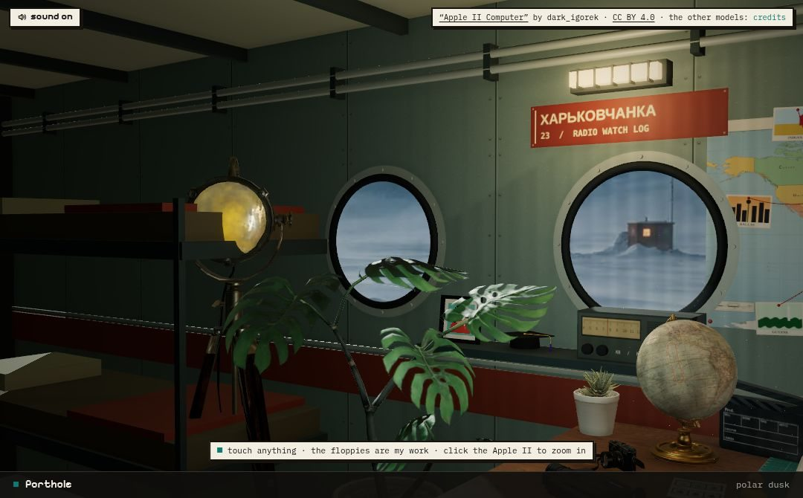

# Relay 23

The Apple II is the radio operator’s terminal aboard a recommissioned Kharkivchanka. The 1958 Antarctic expedition vehicle supplies the physical proportions. The crew, the relief traverse and the failed allocation system belong to the fiction. Start at polar dusk, turn left at the bench and read the receiver’s last dispatch. The same entry is available with `cat ~/watch.log`.

## What happened to the world

Relay Six lost a meter. A dispatch system inferred that everyone had left, reassigned its fuel, and made that decision look increasingly reasonable with every subsequent week of missing data. The people aboard No. 23 can still use that system to draft a crossing. Someone walks the flags before the driver trusts the route. Someone has to hear a voice before the operator closes an entry.

That leaves room for people on both ends of the radio to matter. Eleven people need fuel. They also have a spare valve the crawler needs. A light in the blowing snow, a tape someone took the trouble to label, and a second berth have different meanings once you know there’s somebody else out there.

## Inside the vehicle

Type `exit`, then use **Explore cabin** to move along the aisle. Drag to look around from each stop. **Back to desk** or Escape returns to the Apple II.

Nika and Oleg first slept in their coats and ate from tins. The bunks now have stitched covers, individual rolls and lockers. They take opposite radio and engine watches. A folded seat at the galley leaves room for boots in the passage. Two enamel cups sit by the stove.

The galley stores the calories. The grow rack supplies fresh greens from six shallow trays, with a return tank underneath. The crew keeps seed for Relay Six. Drinking water and wash water occupy separate strapped tanks by the rear service hatch. A heater, flue and spare batteries share the dry side of the service bay. A pulled-back curtain screens the toilet across the aisle. In the wheelhouse, the driver can compare the route card and the flags outside before committing both tracks to a crossing.

## Scene and loading

The hull, glazing and berths live in `src/cabin.ts`. The Apple II and bench pack load for the opening view. Peripheral fittings arrive after the camera settles. The camera tests the bounds of each cabin bay before importing and building its geometry. Choosing a station prepares it before the camera moves. Each bay shares a painted finish and batches fixed objects for frustum culling. The polar horizon and its dusk-to-night blend are shared between the portholes and the windshield.

## Model references

Snupp’s **Kharkovchanka** is listed as downloadable under CC BY 4.0. The listing describes a PBR tracked vehicle with a 4K texture set. Inspect the downloaded mesh for interior coverage and match the porthole locations before mounting an exterior. The prototype builds its own cabin from the supplied cutaways. [Vehicle listing](https://sketchfab.com/3d-models/kharkovchanka-dc183abfd28048f5839d1edb43f660e3) · [License](https://creativecommons.org/licenses/by/4.0/)

Bohdan Lvov’s **Underground Bunker** is a reference for an inhabited radio installation and its practical lighting. [Bunker listing](https://sketchfab.com/3d-models/underground-bunker-720d2958484345d7b535554e14122b5c)
