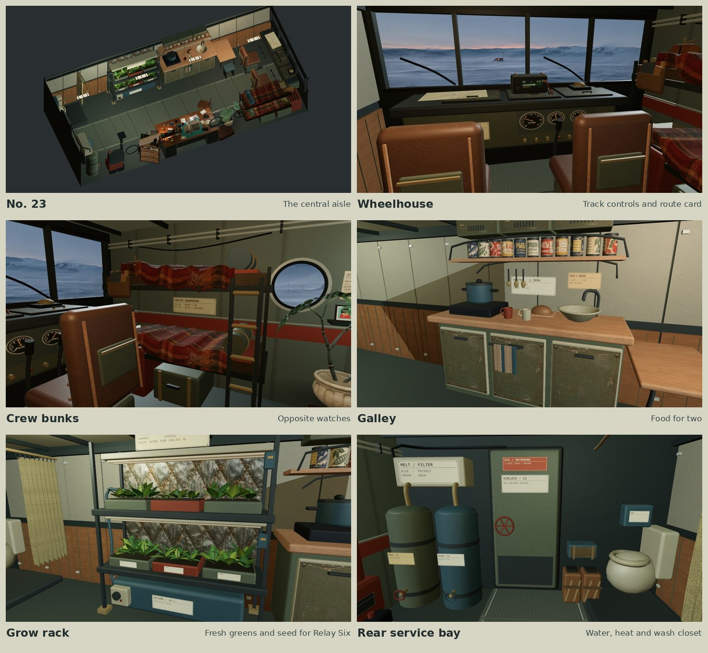

# Relay 23

The Apple II is the radio operator’s terminal aboard a recommissioned Kharkivchanka. The 1958 Antarctic expedition vehicle supplies the physical proportions. The crew, the relief traverse and the failed allocation system belong to the fiction. Start at polar dusk, turn left at the bench and read the receiver’s last dispatch. The same entry is available with `cat ~/watch.log`.

[Follow the build from the original desk to the ice outside.](visual-history.md)

## What happened to the world

Relay Six lost a meter. A dispatch system inferred that everyone had left, reassigned its fuel, and made that decision look increasingly reasonable with every subsequent week of missing data. The people aboard No. 23 can still use that system to draft a crossing. Someone walks the flags before the driver trusts the route. Someone has to hear a voice before the operator closes an entry.

That leaves room for people on both ends of the radio to matter. Eleven people need fuel. They also have a spare valve the crawler needs. A light in the blowing snow, a tape someone took the trouble to label, and a second berth have different meanings once you know there’s somebody else out there.

## Inside the vehicle

Type `exit` and choose **Walk**. Move with WASD or the touch arrows and drag to look around. The keyboard arrow keys also move forward, back and turn. Click or tap a cabin plate to read it. **Resume walk** returns you to the same spot and facing. While walking, **Back to desk** or Escape returns to the Apple II bench. **Explore cabin** offers shortcuts to the five stations.

Nika and Oleg first slept in their coats and ate from tins. The bunks now have stitched covers, individual rolls and lockers. They take opposite radio and engine watches. A folded seat at the galley leaves room for boots in the passage. Two enamel cups sit by the stove.

The galley stores the calories. The grow rack supplies fresh greens from six shallow trays, with a return tank underneath. The crew keeps seed for Relay Six. Drinking water and wash water occupy separate strapped tanks by the rear service hatch. A heater, flue and spare batteries share the dry side of the service bay. A pulled-back curtain screens the toilet across the aisle. In the wheelhouse, the driver can compare the route card and the flags outside before committing both tracks to a crossing.

## Scene and loading

The hull, glazing and berths live in `src/cabin.ts`. The Apple II and bench pack load for the opening view. Peripheral fittings arrive after the camera settles. The camera tests the bounds of each cabin bay before importing and building its geometry. Choosing a station prepares it before the camera moves. Cabin fittings share a generated WebP atlas of rubbed enamel, duck canvas, birch and seat leather. Phones load a 512-pixel version and larger displays load a 1024-pixel version. Fixed objects are batched by bay for frustum culling. The cabin renders directly to an antialiased canvas. The polar horizon and its dusk-to-night blend are shared between the portholes and the windshield.

## Model references

The exterior uses Snupp’s **Kharkovchanka**. Select **Vehicle exterior** in **Explore cabin**, or turn the aft hatch wheel in the water and heat bay. Drag to orbit, scroll or pinch to zoom. The arrow keys and +/− also work in the exterior view. **Back inside** or Escape restores your cabin position.

The supplied exterior includes No. 23’s painted hull, portholes, tracked undercarriage, headlights and roof hardware. Its length is scaled uniformly to 8.5 m, with the windshield at the wheelhouse end. The lived-in cabin is a separate reconstruction from the supplied cutaways. The exterior uses the same polar landscape and the current dusk or night watch. [Original model by Snupp](https://sketchfab.com/3d-models/kharkovchanka-dc183abfd28048f5839d1edb43f660e3) · [License and modifications](../public/models/kharkovchanka.LICENSE.txt)

For web delivery, 23 static meshes share one draw with 46,526 triangles. The original 4K paint was resized to 2K, the normal and packed material maps to 1K, and the emissive mask to 256 pixels. The 843.6 KiB GLB loads on the first trip outside. Returning inside releases the exterior geometry and textures. Rebuild it with `node scripts/optimize-crawler.mjs path/to/scene.gltf public/models/kharkovchanka.glb`.

Bohdan Lvov’s **Underground Bunker** is a reference for an inhabited radio installation and its practical lighting. [Bunker listing](https://sketchfab.com/3d-models/underground-bunker-720d2958484345d7b535554e14122b5c)

The South Pole Station archive shows the first-generation tractors on the 1959 traverse, including Navy photographs at the Pole. These are a period reference for the hull, windows and tracks. The living arrangements aboard No. 23 follow the supplied cutaways and the needs of its fictional crew. [1959 traverse photographs](https://www.southpolestation.com/trivia/igy1/dralkin1.html)

## What informed the refit

The photograph of the worn cab shows a long metal enclosure immediately below the sloping windshields, with separate lift-out covers and loop handles. No. 23 carries that detail through to the wheelhouse. The cutaways supplied for the project guided the bunks, passage and galley. The repeater, garden and crew belongings are later additions in the fiction. [Interior photograph](https://img.novosti-n.org/upload/ukraine/672715.jpg) · [Photograph in context](https://novosti-n.org/ukraine/Arktycheskyj-vezdehod-Harkovchanka-na-snymkah-FOTO-250425)

The vented galley cupboards and closely spaced work surfaces draw on Mike Hill’s designs for K’s apartment in *Blade Runner 2049*. The small HF repeater takes its green readout and amber controls from the instrument hierarchy in Martí Romances’s work for the Milano in *Guardians of the Galaxy*. For the cyberpunk influence, V’s apartment suggested how to give a small room an identifiable occupant. Here the traces are a pouch of books on one bunk, a darned blanket and Nika’s saved bread heel. [K’s apartment and kitchen](https://www.mikehill.design/blade-runner-2049/) · [Milano screen designs](https://www.martiromances.com/the-guardians-of-the-galaxy/) · [V’s apartment environment art](https://jpthrash.artstation.com/projects/XnYKBw)

The corrected allocation slip beside the porthole records what the computer missed. Relay Six lost its meter. Irena answered the radio at 04:17 and confirmed eleven people. In the wheelhouse, Oleg’s pencilled route detours around the lead the routing model missed. By the rear hatch, two fuel cans and a replacement meter are packed for the next sledge. The crew is still waiting for the spare valve offered in return.

The bunks use a mesh authored in Blender. Its UVs cross the curved edge so the weave follows the hanging cloth. Rebuild it from the repository root with `blender -b --python scripts/build-bunk-cover.py`. The fitted cabinets, engine covers, repeater and water equipment are modeled in Three.js. The wool, foil, can wrappers and chipped panel share an ImageGen texture sheet, with material-specific roughness and metalness. The scene loads the sheet when a bay is needed and requests the blanket mesh when the berths are built.

### Measured cost of the five bays

Measured at the crew refit (`1dc048d`) in Chromium after visiting the wheelhouse, berths, galley, garden and service bay, with the same station cameras on both revisions. The figures below cover the five station groups. The original desk, hull and texture memory are outside this count.

| Resident station geometry | Before the refit | After the refit |
| --- | ---: | ---: |
| Stored vertices | 93,071 | 21,480 |
| Vertex, index and instance buffers | 4,110,752 bytes | 950,484 bytes |
| Triangles across all five bays, including instanced leaves | 32,330 | 36,400 |
| Mesh objects across the five bays | 25 | 30 |

Adjacent faces now reuse matching vertices, and vertex tints use three bytes. That frees buffer space for curved leaf blades, cloth folds and small hardware. The 216 leaves still share one instanced mesh. Desktop downloads 290 KiB for the additional WebP sheet, phones download 68 KiB, and the reusable blanket mesh adds 17 KiB. These are transfer sizes. A decoded 1024-square RGBA texture with mipmaps occupies about 5.3 MiB of graphics memory.
