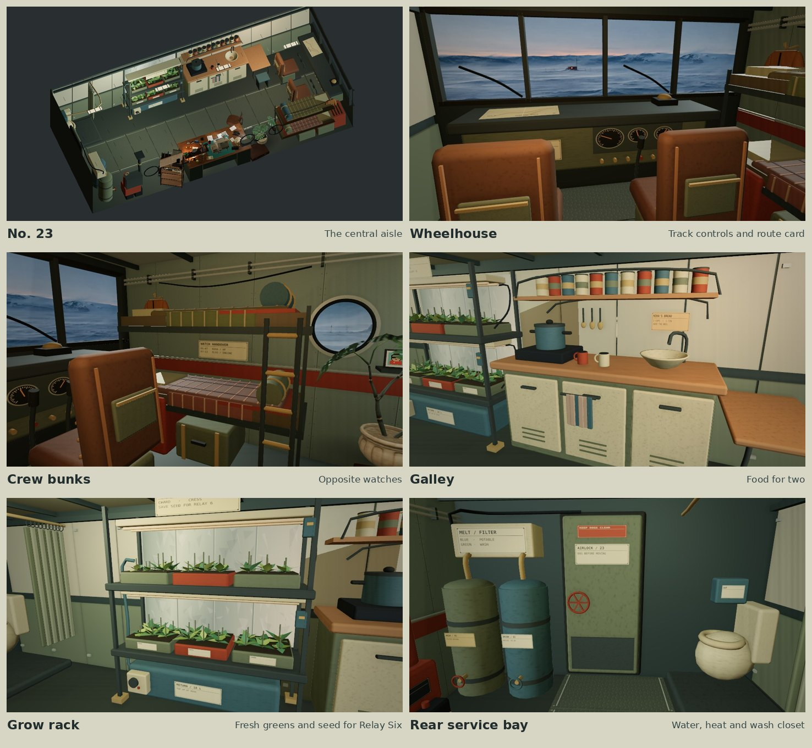
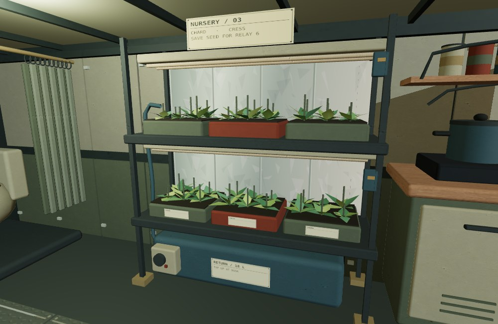
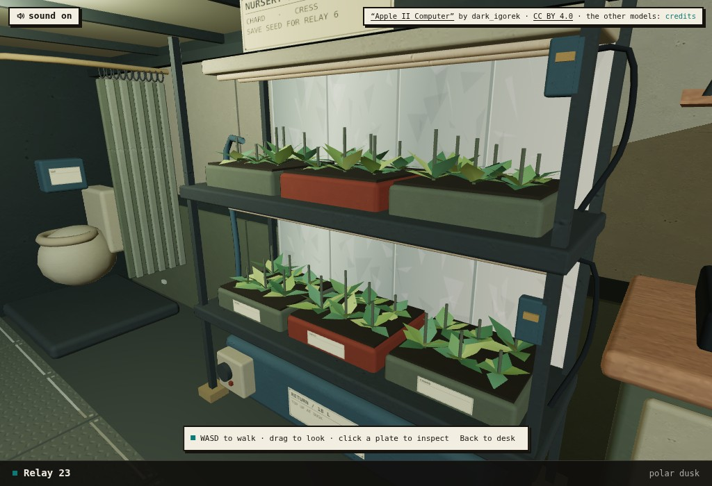
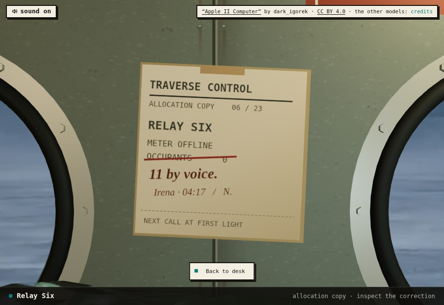
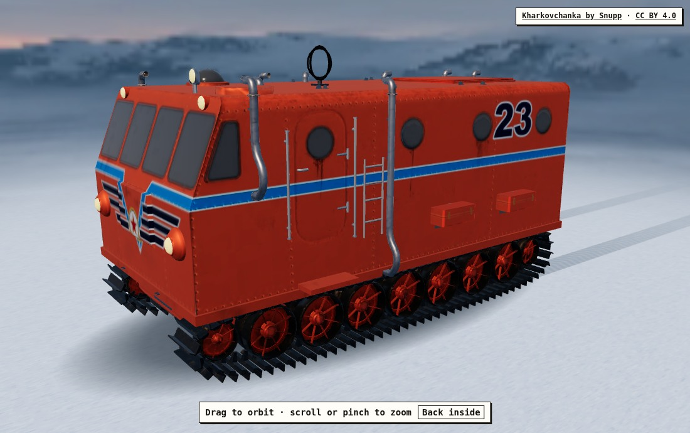
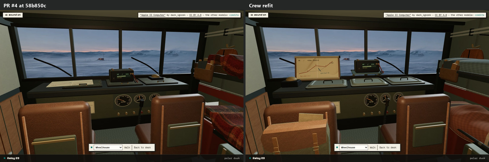
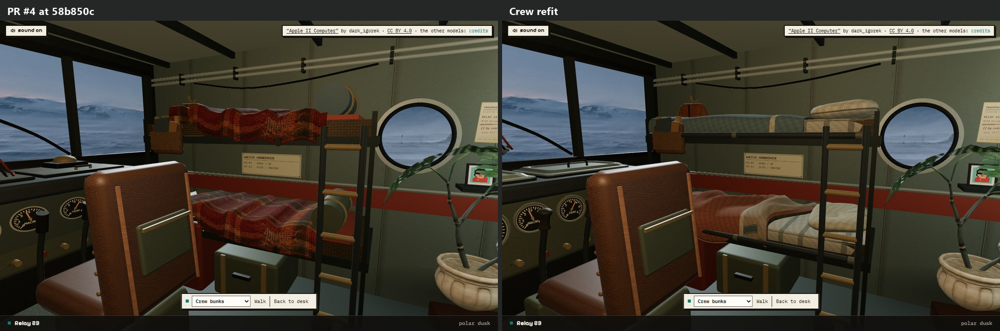
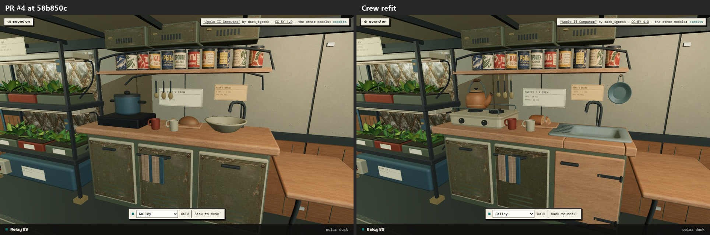
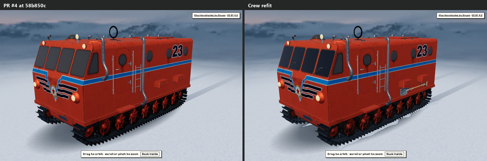
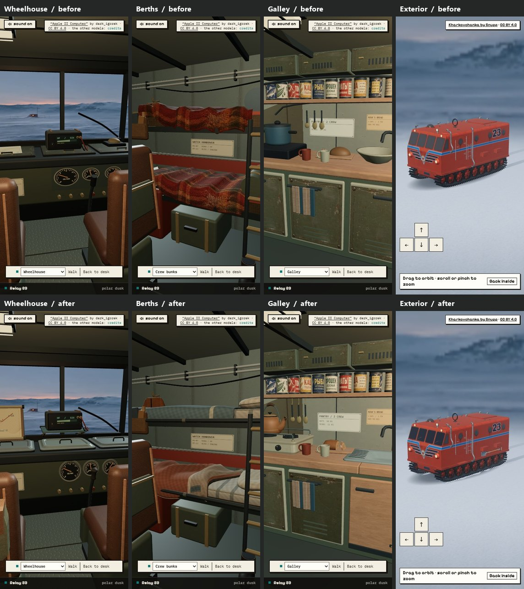

# From a desk to Relay 23

Development captures from November 27, 2026. The Apple II is a useful landmark across these images. At first it occupies most of the room you can see. Later captures follow the crew through the grow rack and out onto the ice.

## The desk before the vehicle

Typing `exit` put the visitor at this desk. The computer, mug and map give us a baseline for comparing later changes to the setting and camera. [Early interactive desk](https://github.com/ChristenJacquottet/terminal-portfolio/commit/550adb1)

## The cassette player gives the desk an owner

The orange foam pads and thin headband place the headphones alongside the TPS-L2-style player. Selecting an Awesome Mix seats the tape in the player while the visitor keeps their view of the desk. [Walkman and headphones revision](https://github.com/ChristenJacquottet/terminal-portfolio/commit/f5c2aa9)

## The first glimpse of the ice

A turn to the left reveals the new setting. The portholes put the desk inside the crawler, and the light across the ice gives the shortwave operator someone to call. [First radio cabin](https://github.com/ChristenJacquottet/terminal-portfolio/commit/33d6465)

## Making room for two people

The cutaway records where things fit. Two crew members can take opposite watches, climb into separate bunks, cook at the galley and reach the water and heater at the rear. The five eye-level views record what a visitor could see from each station before free walking was added. [Two-crew layout](https://github.com/ChristenJacquottet/terminal-portfolio/commit/9f82259)

## Details worth walking up to

The two mugs sit within reach of one another. The birch worktop and painted cabinet doors show where the shared material atlas landed on the galley.

The galley tins provide calories. The trays provide fresh greens. The nursery plate connects the garden to the radio story with a note from the crew. “Save seed for Relay 6.” [Walk and surface-material revision](https://github.com/ChristenJacquottet/terminal-portfolio/commit/6dfa4ad)

## One terminal, two views

The seated terminal keeps a one-pixel dark line every three CSS pixels. Opening the original-size PNG makes the effect easier to see. The `crt off` command gives the reader a plain screen.

This capture includes the walking controls. On leaving the terminal, the scanline layer switches off before the screen shrinks into the Apple II. In the aisle, the rack, its printed plate and the controls all render clearly.

## Giving the cabins a working history

From the driver’s seat, the biggest change sits just under the windshields. The line of handled engine covers follows an interior photograph. The little HF repeater strapped between them belongs to the later crew. At the bunks, the edge of a Blender-modeled blanket folds around the rail. At the galley, an open tin shelf, rubbed cabinet doors and the saved bread heel make Nika’s recipe part of the room. [Interior references and measured rendering cost](relay-23.md#what-informed-the-refit)

Nika kept the erroneous slip and signed the correction. A visitor can read that somebody called back before learning the rest of the story in the terminal log.

## Through the aft hatch

Until this revision, visitors knew the crawler by what they could see from inside it. Turning the aft hatch wheel now lets them see how high the bunks and radio bench ride above the ice. Snupp’s original paint keeps the blue stripe, vehicle number and worn metal around the fittings legible as the camera comes closer. The exterior loads on the first trip outside. [Model, license and rendering budget](relay-23.md#model-references)

## Working aboard No. 23

The left image in each pair is draft PR head `58b850c`. The right image is the crew refit. These are in-game captures at polar dusk. The cutaway supplied for the project establishes the vehicle the two operators found. The pockets, textiles and hardware show how they live with it. [Selected references and credits](relay-23-references.md)

The original low console stays in place. Three raised lids can be reached from inside the cab. Oleg's bag rides on the seat back within reach of the chart. The small compass sits on the fixed dash.

One crew member is up while the other sleeps. The lower pillow and blanket carry the weight of the last sleeper. The upper bunk has a tight hem aligned with the steel rail.

A pan hangs by its handle to keep the counter clear. The door below the sink was cut from birch and finished with a kick strip to protect its lower edge. The mugs and Nika's saved bread heel stay beside the hob.

The offset brackets and straps carry a service scoop without blocking the ladder. The two parked wipers stand off from the flat glass on pivot washers. Both tread trails align with the running gear. The inherited hull and paint are Sergey Gorbatenko (Snupp)'s CC BY 4.0 work. [Original model and modifications](../public/models/kharkovchanka.LICENSE.txt)

The phone pairs reuse the original camera positions and orientations. During ordinary play the wheelhouse and galley shortcuts now frame their fittings for portrait screens. At the bench, the portrait camera stays inside the hull. Visitors can read Nika's exchange docket on the outbound meter and resume walking where they stopped. [Read the docket in the game view](progression/09-exchange-docket.jpg)

### Cost on the same route

Chromium on Windows, 1152 × 720 desktop and 390 × 844 with touch emulation, both at DPR 1. Each cold browser entered `exit`, selected each station, walked, opened the exterior through the wheel, orbited and returned. The matched phone measurements use the original camera, apart from the repaired opening desk. Each cell reads **before → after**.

| View | Desktop draws / triangles | Phone draws / triangles |
| --- | ---: | ---: |
| Radio bench | 447 / 333,403 → 443 / 314,023 | 188 / 233,063 → 69 / 77,081 |
| Wheelhouse | 28 / 22,608 → 27 / 32,876 | 24 / 17,844 → 24 / 21,522 |
| Berths | 42 / 29,366 → 41 / 39,634 | 25 / 22,598 → 25 / 32,872 |
| Galley | 31 / 38,398 → 33 / 47,782 | 26 / 33,094 → 27 / 39,870 |
| Grow rack | 29 / 29,660 → 29 / 34,770 | 26 / 22,546 → 26 / 21,800 |
| Water and heat | 28 / 20,258 → 28 / 20,794 | 24 / 20,250 → 24 / 20,786 |
| Exterior | 6 / 48,592 → 9 / 57,764 | 6 / 48,592 → 9 / 57,764 |

| Cumulative cost | Desktop | Phone |
| --- | ---: | ---: |
| Opening desk, transfer in KiB | 6,397.0 → 6,097.2 | 5,248.5 → 5,170.7 |
| Opening desk, tracked texture storage in MiB | 371.7 → 366.4 | 162.0 → 113.2 |
| All five bays, transfer in KiB | 6,414.0 → 6,573.2 | 5,265.5 → 5,424.8 |
| All five bays, tracked texture storage in MiB | 397.6 → 397.8 | 188.5 → 147.0 |
| First exterior orbit, transfer in KiB | 7,265.8 → 7,484.5 | 6,117.4 → 6,336.1 |
| First exterior orbit, tracked texture storage in MiB | 434.6 → 434.8 | 225.5 → 184.0 |

Draws and triangles come from Three.js renderer counters for the settled frame. Transfer is the sum of browser Resource Timing transfer sizes for the production preview, including response headers. Texture storage is an estimate of live WebGL `texStorage2D` allocations for recognized formats including mip levels and cube faces. The estimate excludes driver overhead, renderbuffers and untracked formats. The figures include resident desk assets throughout the route.

In a separate run with ordinary camera motion, median time from entering `exit` to the desk controls over three alternating cold launches was 8.11 → 7.82 s on desktop and 5.14 → 4.98 s at phone size. These are local preview timings on the same Windows machine.

The three interior close-ups were also checked on night watch, with the power strip off, and after power was restored. Physical phone GPU performance and a comparison against the missing second vehicle archive remain unverified. [Blender rebuild instructions](relay-23.md#the-crews-working-refit)
