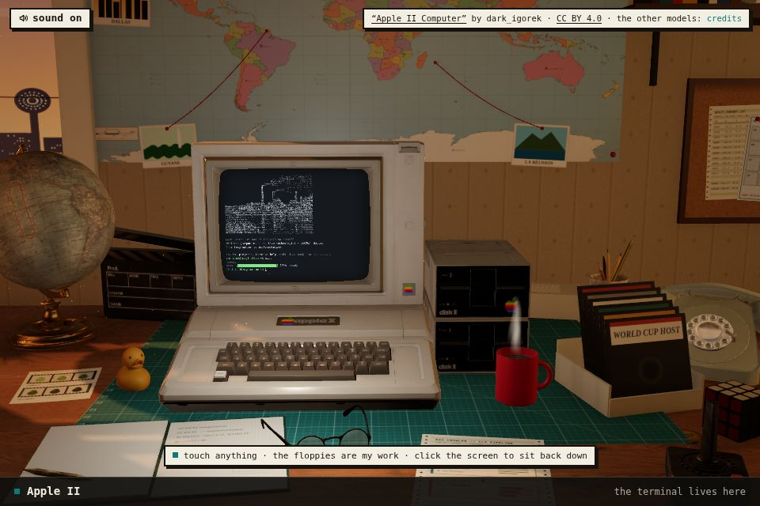
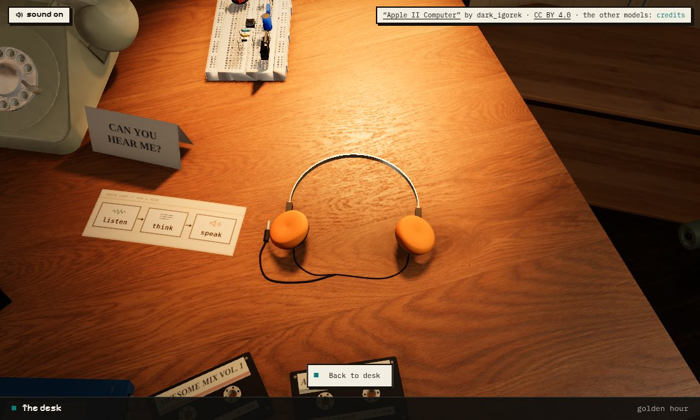
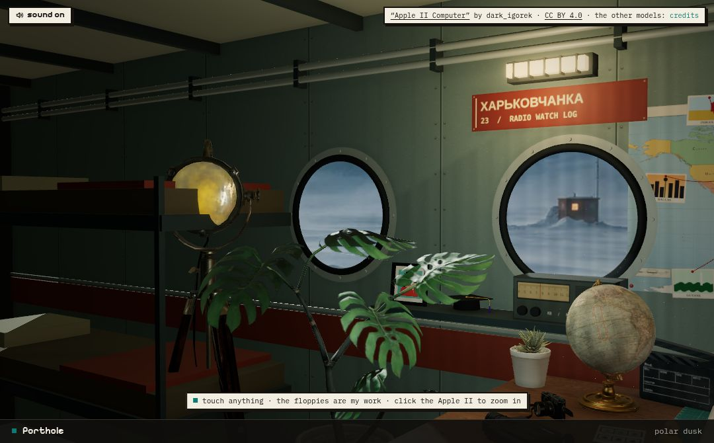
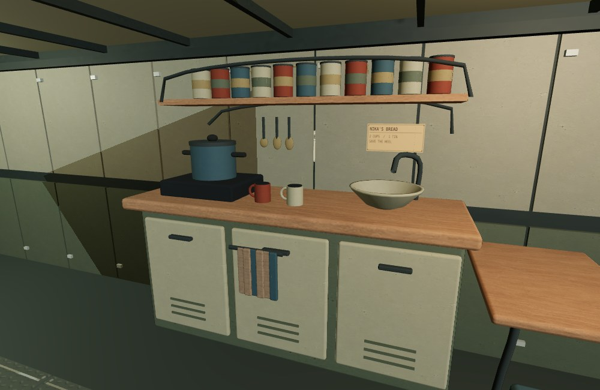
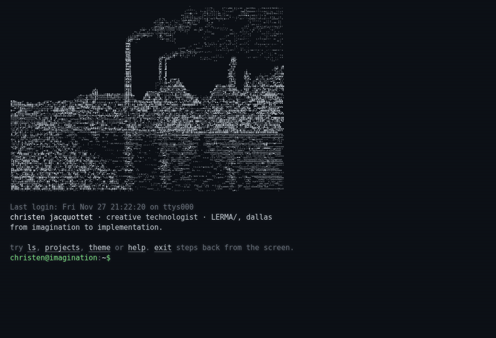
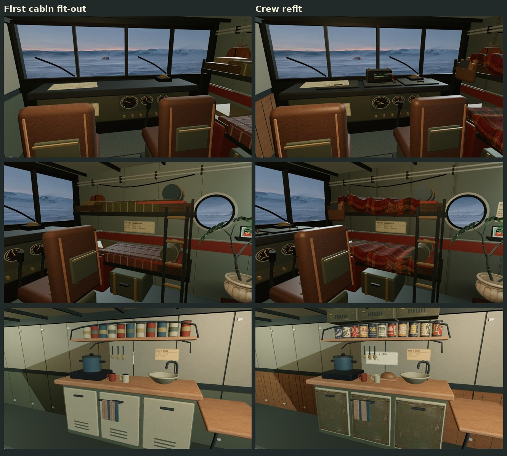

# From a desk to Relay 23

Development captures from November 27, 2026. The Apple II is a useful landmark across these images. At first it occupies most of the room you can see. Later captures follow the crew through the grow rack and out onto the ice.

## The desk before the vehicle

Typing `exit` put the visitor at this desk. The computer, mug and map give us a baseline for comparing later changes to the setting and camera. [Early interactive desk](https://github.com/ChristenJacquottet/terminal-portfolio/commit/550adb1)

## The cassette player gives the desk an owner

The orange foam pads and thin headband place the headphones alongside the TPS-L2-style player. Selecting an Awesome Mix seats the tape in the player while the visitor keeps their view of the desk. [Walkman and headphones revision](https://github.com/ChristenJacquottet/terminal-portfolio/commit/f5c2aa9)

## The first glimpse of the ice

A turn to the left reveals the new setting. The portholes put the desk inside the crawler, and the light across the ice gives the shortwave operator someone to call. [First radio cabin](https://github.com/ChristenJacquottet/terminal-portfolio/commit/33d6465)

## Making room for two people

The cutaway records where things fit. Two crew members can take opposite watches, climb into separate bunks, cook at the galley and reach the water and heater at the rear. The five eye-level views record what a visitor could see from each station before free walking was added. [Two-crew layout](https://github.com/ChristenJacquottet/terminal-portfolio/commit/9f82259)

## Details worth walking up to

The two mugs sit within reach of one another. The birch worktop and painted cabinet doors show where the shared material atlas landed on the galley.

The galley tins provide calories. The trays provide fresh greens. The nursery plate connects the garden to the radio story with a note from the crew. “Save seed for Relay 6.” [Walk and surface-material revision](https://github.com/ChristenJacquottet/terminal-portfolio/commit/6dfa4ad)

## One terminal, two views

The seated terminal keeps a one-pixel dark line every three CSS pixels. Opening the original-size PNG makes the effect easier to see. The `crt off` command gives the reader a plain screen.

This capture includes the walking controls. On leaving the terminal, the scanline layer switches off before the screen shrinks into the Apple II. In the aisle, the rack, its printed plate and the controls all render clearly.

## Giving the cabins a working history

From the driver’s seat, the biggest change sits just under the windshields. The line of handled engine covers follows an interior photograph. The little HF repeater strapped between them belongs to the later crew. At the bunks, the edge of a Blender-modeled blanket folds around the rail. At the galley, an open tin shelf, rubbed cabinet doors and the saved bread heel make Nika’s recipe part of the room. [Interior references and measured rendering cost](relay-23.md#what-informed-the-refit)

Nika kept the erroneous slip and signed the correction. A visitor can read that somebody called back before learning the rest of the story in the terminal log.

## Through the aft hatch

Until this revision, visitors knew the crawler by what they could see from inside it. Turning the aft hatch wheel now lets them see how high the bunks and radio bench ride above the ice. Snupp’s original paint keeps the blue stripe, vehicle number and worn metal around the fittings legible as the camera comes closer. The exterior loads on the first trip outside. [Model, license and rendering budget](relay-23.md#model-references)
